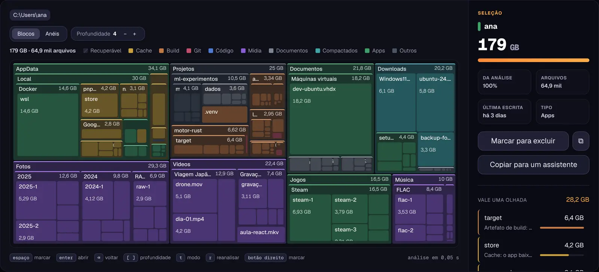
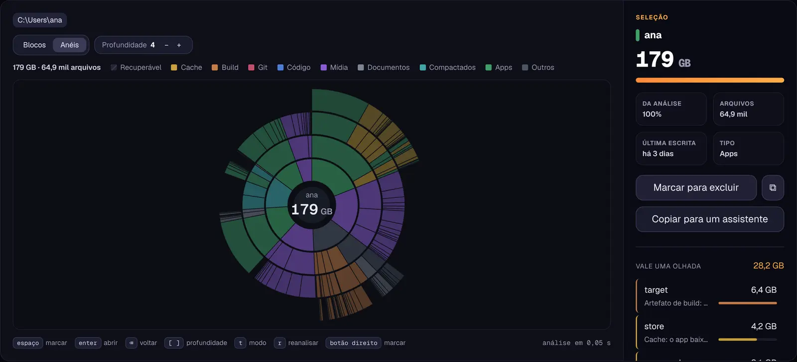
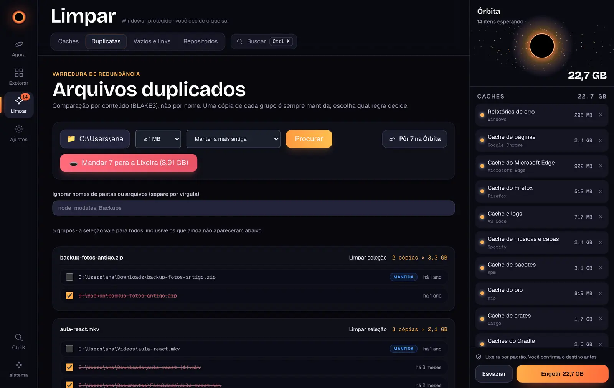
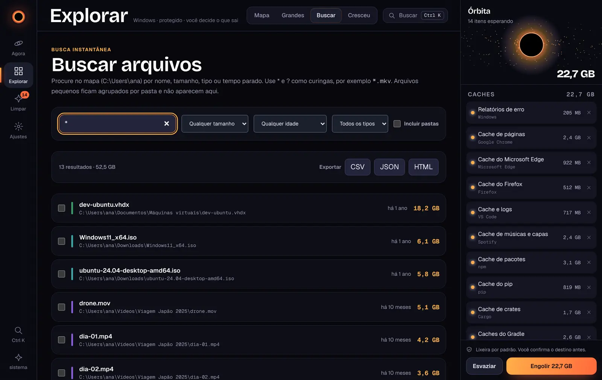
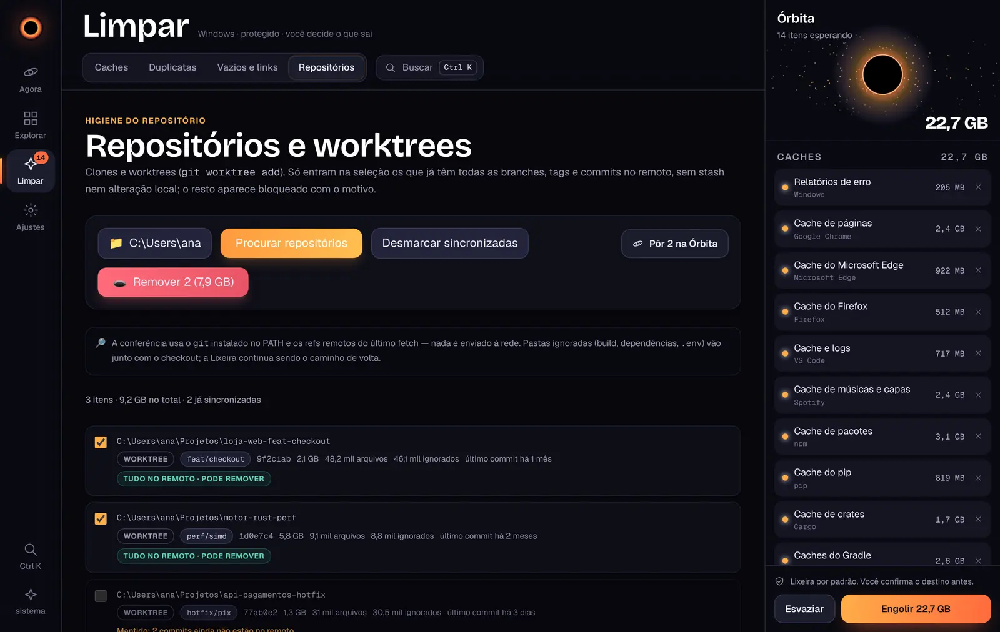
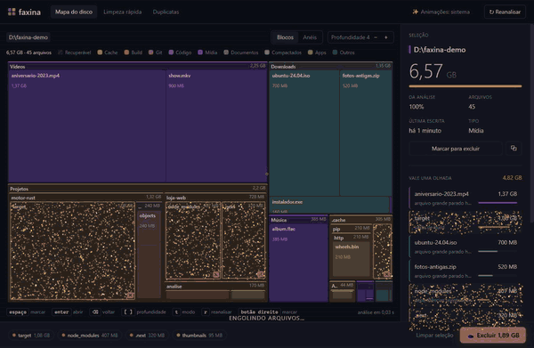
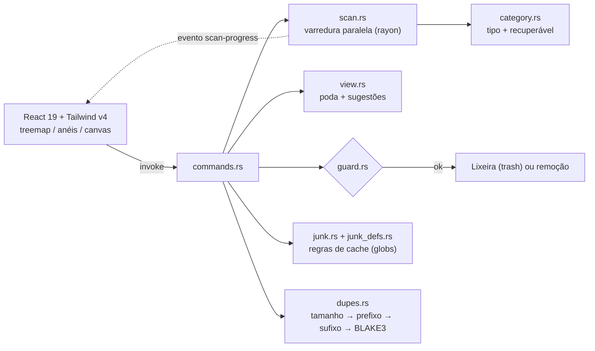
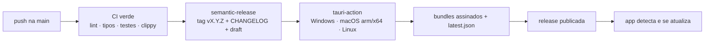

<div align="center">


<br />

[](https://github.com/juninmd/faxina/releases/latest)
[](https://github.com/juninmd/faxina/releases)
[](https://github.com/juninmd/faxina/actions/workflows/ci.yml)
[](LICENSE)


[](https://www.conventionalcommits.org/pt-br/)

**[⬇ Baixar](https://github.com/juninmd/faxina/releases/latest)** · [Funcionalidades](#-o-que-ele-faz) · [Telas](#-tour-pelas-telas) · [Uso](#-uso) · [Segurança](#-segurança-primeiro) · [Atalhos](#-atalhos) · [Arquitetura](#-como-funciona) · [Desenvolvimento](#-desenvolvimento)

</div>

---

O disco encheu e você não sabe por quê? O **Faxina** mostra onde o espaço foi parar, sugere o que é seguro apagar (caches, `node_modules`, `target/`, duplicatas, worktrees esquecidas) e remove tudo **com a Lixeira como padrão**. É um app nativo leve, com o motor em Rust e a interface em React.

<table>
  <tr>
    <td width="33%" align="center">
      <h3>🗺️ Enxergue</h3>
      Mapa do disco em blocos ou anéis, com cada tipo de arquivo numa cor e o que dá para recuperar hachurado.
    </td>
    <td width="33%" align="center">
      <h3>🧹 Decida</h3>
      Caches, builds, duplicatas e repositórios já enviados ao remoto, cada um com o motivo e o tamanho.
    </td>
    <td width="33%" align="center">
      <h3>🕳️ Engula</h3>
      Junte tudo na Órbita e mande para o buraco negro. O Rust confere cada caminho antes de remover.
    </td>
  </tr>
</table>

<div align="center">
  
  <sub><b>Agora</b>: o resumo do disco, o que dá para liberar e a Órbita à direita, com tudo que está esperando o buraco negro.</sub>
</div>

## ✨ O que ele faz

| | |
|---|---|
| 🗺️ **Mapa do disco** | Analise a pasta pessoal, qualquer pasta ou um disco inteiro (C:, D:…) e troque a qualquer momento. Treemap em blocos ou anéis concêntricos. Cada cor é um tipo: cache, build, git, código, mídia, documentos, compactados, apps. Hachurado = **recuperável**. |
| 💡 **Vale uma olhada** | Lista automática do que dá para apagar sem dor: `node_modules`, `target/` de projetos Rust, Maven e sbt, `.next`, `__pycache__`, `.venv`, `__pypackages__`, `.build` do SwiftPM, `elm-stuff`, `zig-out`, caches e arquivos gigantes parados há meses. |
| 📈 **O que cresceu** | Cada análise guarda os tamanhos das pastas grandes neste computador; na próxima, o Faxina mostra o que cresceu desde a última vez. |
| 🔎 **Busca e relatórios** | Busca instantânea no mapa por nome (com `*` e `?`), tamanho, tipo e tempo parado ("não mexo há 1 ano"), com exportação em CSV, JSON ou HTML. |
| 📦 **Arquivos grandes** | Os maiores arquivos da área analisada, de qualquer idade, para quando o que pesa não é cache nem duplicata. |
| 🧹 **Limpeza de caches** | Windows, navegadores (Chrome, Edge, Brave, Vivaldi, Firefox, Thunderbird), apps (VS Code, Discord, Slack, Spotify, Teams, Cursor, Adobe), apps da Microsoft Store, launchers e ferramentas de dev (npm, Yarn, pnpm, pip, uv, Poetry, Bun, Cargo, Gradle, Rustup, Maven, go, NuGet, Composer, Dart/Flutter, JetBrains, Playwright, Hugging Face…). Tem **Simular** antes de limpar. **Nunca** toca em cookies, senhas ou histórico. |
| 👯 **Duplicatas** | Comparação por conteúdo em 4 etapas (tamanho → prefixo → sufixo → BLAKE3 completo). Mantém uma cópia de cada grupo e nunca deixa você marcar todas. |
| 🗂️ **Vazios e links** | Pastas vazias e links quebrados. Os links quebrados vão sempre para a Lixeira. |
| 🌿 **Repositórios e worktrees** | Encontra checkouts criados com `git worktree add` e libera só os que já têm todos os commits no remoto, sem alterações locais nem trava. O resto fica listado com o motivo. |
| 🕳️ **Buraco negro** | Ao excluir, os blocos se desintegram e espiralam para dentro de um buraco negro, que colapsa numa onda de choque com o total liberado. |
| ⌨️ **Linha de comando** | `faxina-cli search`, `faxina-cli scan` e `faxina-cli junk`, só leitura: nunca apaga nada. |
| 🔄 **Auto-update** | O app procura novas versões no GitHub Releases; os pacotes são assinados e você decide quando instalar. |

## 📸 Tour pelas telas

<table>
  <tr>
    <td colspan="2">
      
      <p align="center"><sub><b>Mapa em blocos</b>: cada pasta no seu lugar, colorida por tipo, com as sugestões “Vale uma olhada” ao lado.</sub></p>
    </td>
  </tr>
  <tr>
    <td colspan="2">
      
      <p align="center"><sub><b>Anéis</b>: a mesma análise em anéis concêntricos. Aperte <code>t</code> para alternar.</sub></p>
    </td>
  </tr>
  <tr>
    <td width="50%">
      
      <p align="center"><sub><b>Caches</b>: revise item a item, com o que acontece ao limpar e onde fica no disco.</sub></p>
    </td>
    <td width="50%">
      
      <p align="center"><sub><b>Duplicatas</b>: por conteúdo, e uma cópia de cada grupo sempre fica.</sub></p>
    </td>
  </tr>
  <tr>
    <td width="50%">
      
      <p align="center"><sub><b>Buscar</b>: nome, curingas, tamanho, tipo e idade, com exportação.</sub></p>
    </td>
    <td width="50%">
      
      <p align="center"><sub><b>Cresceu</b>: o que engordou desde a última análise.</sub></p>
    </td>
  </tr>
  <tr>
    <td colspan="2">
      
      <p align="center"><sub><b>Repositórios</b>: só sai o que já está inteiro no remoto; o resto mostra o motivo.</sub></p>
    </td>
  </tr>
</table>

<div align="center">
  
  <br /><sub>O buraco negro em ação.</sub>
</div>

<sub>Capturas feitas com dados de demonstração.</sub>

## ⬇ Instalação

Baixe o instalador da [última versão](https://github.com/juninmd/faxina/releases/latest):

| Sistema | Arquivo |
|---|---|
|  | `Faxina_x.y.z_x64-setup.exe` (ou `.msi`) |
|  | `Faxina_x.y.z_aarch64.dmg` |
|  | `Faxina_x.y.z_x64.dmg` |
|  | `.AppImage`, `.deb` ou `.rpm` |

> [!NOTE]
> Os binários ainda não têm assinatura de código da Microsoft/Apple. No Windows, o SmartScreen pede **Mais informações → Executar assim mesmo**; no macOS (assinatura ad-hoc), abra com **botão direito → Abrir** na primeira vez. Se aparecer “danificado”, rode `xattr -cr /Applications/Faxina.app`. As *atualizações* são assinadas com a chave do updater do Tauri, então o app só aceita pacotes publicados por este repositório.

## 🚀 Uso

O app é dividido em quatro espaços na barra lateral: **Agora** (resumo), **Explorar** (Mapa, Grandes, Buscar, Cresceu), **Limpar** (Caches, Duplicatas, Vazios e links, Repositórios) e **Ajustes**. `Ctrl K` abre a paleta de comandos de qualquer lugar.

1. **Escolha a área.** Em *Explorar → Mapa*, mapeie a pasta pessoal, outra pasta ou um disco inteiro. A varredura mostra o progresso e, ao terminar, o mapa.
2. **Navegue.** Enter ou duplo clique entra na pasta; Backspace volta; `t` alterna entre Blocos e Anéis.
3. **Junte na Órbita.** Espaço ou botão direito marca um bloco; caches, duplicatas, vazios e worktrees também podem ir para a Órbita.
4. **Engula.** “Engolir” abre a confirmação (Lixeira por padrão) e o buraco negro mostra o espaço liberado.

Cada painel de *Limpar* também tem o próprio botão de remover. Caches são resolvidos por ID e duplicatas por conteúdo, nunca por caminho vindo da interface; worktrees só saem se estiverem inteiras no remoto.

<details>
<summary><b>⌨️ Linha de comando (somente leitura)</b></summary>

```bash
faxina-cli search ~/ --older-than 12m --min-size 500MB --format csv
faxina-cli search ~/Downloads --text "*.iso"
faxina-cli scan ~/Projetos --top 10
faxina-cli junk
```

Nenhum comando apaga nada: a CLI só lista e exporta.

</details>

<details>
<summary><b>🧪 Testar sem tocar nos seus arquivos</b></summary>

Para experimentar sem tocar nos seus arquivos, gere uma pasta de demonstração (caches, builds e duplicatas falsos) e analise-a no app:

```bash
bun scripts/demo-fixture.ts ./demo
# demo fixture ready at C:\...\demo
ls ./demo
# AppData  Documentos  Downloads  Fotos  Música  Projetos  Vídeos
```

O script recusa um destino que já existe, para nunca escrever sobre dados reais:

```bash
bun scripts/demo-fixture.ts ./demo
# refusing to write into existing path: ./demo
```

Sem argumento, ele imprime o uso e sai com código 1:

```bash
bun scripts/demo-fixture.ts
# usage: bun scripts/demo-fixture.ts <target-dir>
```

</details>

## 🔒 Segurança primeiro

- **Lixeira por padrão.** Exclusão permanente é opt-in, com confirmação — e a escolha do diálogo vale também para a limpeza de caches, não só para o mapa.
- **O Rust não confia na interface.** Todo caminho enviado para exclusão passa por um guarda: precisa ser absoluto, sem `..`, existir, estar **dentro** da pasta analisada (nunca a própria raiz) e fora de pastas protegidas (sistema, `Arquivos de Programas`, sua pasta pessoal e Documentos/Imagens/Downloads inteiros).
- **Recuperável só por nome, nunca por cor.** Uma pasta cheia de `target/` é pintada de “Build”, mas só o `target/` é sugerido — o código-fonte ao lado fica.
- **Limpeza rápida por ID.** A interface manda o ID do cache (ex.: `chrome`), e o backend resolve os caminhos de uma lista fixa. Cada regra mira a pasta inteira ou só arquivos que casam um padrão (ex.: `*.log`), e pode preservar nomes específicos (exclusões). Apaga o *conteúdo* da pasta, não a pasta; arquivos em uso são pulados e contados. Em `%TEMP%`, só o que tem mais de 24 h.
- **Links simbólicos e junctions são ignorados** na análise, então nada é contado duas vezes nem “escapa” da pasta escolhida.

## ⌨ Atalhos

| Tecla | Ação |
|---|---|
| `Tab` | percorre os blocos do nível atual |
| `Enter` / duplo clique | abrir pasta |
| `Espaço` / botão direito | marcar ou desmarcar para excluir |
| `Backspace` / centro dos anéis | voltar um nível |
| `[` `]` | menos / mais profundidade |
| `t` | alternar Blocos ↔ Anéis |
| `r` | reanalisar |

> [!TIP]
> O Faxina respeita a configuração **“Efeitos de animação”** do sistema. Se ela estiver desligada, o buraco negro vira uma versão curta. Para ver a animação completa mesmo assim, clique em **✨ Animações** no topo até ficar em **sempre**.

## 🧭 Como funciona



- A varredura guarda a árvore em memória; arquivos menores que 512 KB viram um bloco “N arquivos pequenos” por pasta, o que mantém milhões de arquivos em algumas centenas de MB.
- A interface recebe só a fatia visível (profundidade + até 60 filhos por pasta) e pede mais ao navegar.
- Excluir atualiza a árvore em memória, sem precisar reanalisar.

## 🛠 Desenvolvimento

Pré-requisitos: [Bun](https://bun.sh) ≥ 1.3, [Rust](https://rustup.rs) estável e os [pré-requisitos do Tauri](https://tauri.app/start/prerequisites/) do seu sistema.

**Configuração:** o app não lê variáveis de ambiente para funcionar. Só o empacotamento assinado (`bun tauri build`) exige `TAURI_SIGNING_PRIVATE_KEY` e `TAURI_SIGNING_PRIVATE_KEY_PASSWORD`, porque o updater está ligado.

```bash
bun install
bun tauri dev            # app com hot reload
bun run build            # tsc + vite build (gera dist/, que o Rust embute)

bun run lint             # Biome
bun run format           # Biome com correção
bun run typecheck        # tsc
bun run test             # testes do frontend (bun test)
cd src-tauri && cargo test && cargo clippy --all-targets -- -D warnings

bun scripts/demo-fixture.ts ./demo   # pasta falsa com caches, builds e duplicatas
```

> [!NOTE]
> Em um clone limpo, rode `bun run build` uma vez antes de `cargo test`: o Tauri embute `../dist` em tempo de compilação.

Saída real dos gates do frontend:

```text
$ bun run test
 85 pass
 0 fail
Ran 85 tests across 18 files.

$ bun run lint
Checked 87 files in 517ms. No fixes applied.

$ bun run typecheck
(sem saída: tipos ok)
```

## 🧪 Testes e gates de CI

| Workflow | Job | O que checa |
|---|---|---|
| `ci.yml` | Conventional commits (só em PR) | Mensagens de commit no padrão Conventional Commits (commitlint, workflow reutilizável de `juninmd/base-actions`) |
| `ci.yml` | Frontend | Validação de PR pelo workflow reutilizável `reusable-validate.yml` de `juninmd/base-actions` (instalação e checagens do projeto, mais auditoria de dependências) |
| `ci.yml` | Rust (Ubuntu, Windows, macOS) | `bun run build`, depois `cargo fmt --check`, `cargo clippy --all-targets -- -D warnings` e `cargo test` em cada sistema |
| `ci.yml` | Dependency audit | Informativo, não bloqueia: `bun audit` e `cargo audit`; achados abertos ficam registrados em [SECURITY.md](SECURITY.md) |
| `security.yml` | Security Scan | Varredura de segurança (workflow reutilizável de `juninmd/base-actions`) no push para `main` e semanalmente |
| `release.yml` | Release | Só roda depois de CI verde na `main`: semantic-release, build assinado por plataforma e publicação do `latest.json` |

### Releases e auto-update

O versionamento é 100% automático a partir de [Conventional Commits](https://www.conventionalcommits.org/pt-br/):

| Commit | Versão |
|---|---|
| `fix: ...` | patch — `1.0.0 → 1.0.1` |
| `feat: ...` | minor — `1.0.0 → 1.1.0` |
| `feat!: ...` ou `BREAKING CHANGE:` | major — `1.0.0 → 2.0.0` |
| `docs:`, `chore:`, `refactor:`, `test:`… | sem release |



PRs têm os commits validados pelo commitlint. Para publicar, o repositório precisa dos secrets `TAURI_SIGNING_PRIVATE_KEY` e `TAURI_SIGNING_PRIVATE_KEY_PASSWORD` (gerados com `bun tauri signer generate`); a chave pública fica em `src-tauri/tauri.conf.json`.

## ⚠ Limitações conhecidas

- Tamanhos são **aparentes** (tamanho do arquivo), não espaço alocado — arquivos esparsos ou comprimidos pelo NTFS podem ocupar menos.
- Hard links contam uma vez só (no Windows, via FileId do NTFS; em FAT/exFAT não existem). O espaço fica com o primeiro caminho encontrado, então `WinSxS` e `System32` dividem o total de um jeito que pode variar entre análises.
- Pastas chamadas só `cache`/`tmp`/`temp` só contam como cache dentro de dados de aplicativo (`AppData`, `~/.cache`, `~/Library`…); em `Documentos/Projeto/tmp` elas são tratadas como suas.
- Arquivos pequenos (< 512 KB) aparecem agrupados e não podem ser marcados individualmente. A lista de **Arquivos grandes** sai da mesma análise e só mostra o que foi rastreado um a um.
- A limpeza rápida só mexe em pastas do usuário; nada que exija administrador (Windows Update, `C:\Windows\Temp`).
- Aplicativos abertos bloqueiam a limpeza de seus caches (ex.: navegadores no Windows com arquivos travados); o app avisa qual programa fechar e pula as entradas bloqueadas por segurança.
- A caça a duplicatas guarda os hashes em `%LOCALAPPDATA%\faxina\dupes-cache.json`; reanalisar a mesma pasta fica bem mais rápido. O hash só é reaproveitado quando tamanho **e** data de modificação não mudam.
- Efeitos de redução de movimento do sistema operacional (`prefers-reduced-motion`) ativam a versão curta da animação do buraco negro por padrão, com opção de forçar animações sempre ativas no topo do app.

## 🗺️ Próximos passos

- [ ] **Regras personalizadas pelo usuário:** suporte a inclusão de pastas customizadas com regras de exclusão declarativas.
- [ ] **Filtros por extensão:** filtros por extensões personalizadas no caçador de arquivos grandes.
- [ ] **Melhorias de acessibilidade contínuas:** suporte a alto contraste aprimorado e atalhos de teclado dedicados para painéis secundários (duplicatas e vazios).
- [ ] **Análise em lote de múltiplos volumes:** varredura simultânea de diferentes discos em segundo plano com agendamento local integrado.

## 🙏 Inspirações

<details>
<summary>Projetos que inspiraram o Faxina</summary>


Levantamento feito no GitHub em 27/09/2026:

| Projeto | O que aprendemos |
|---|---|
| [BleachBit](https://github.com/bleachbit/bleachbit) · [Winapp2.ini](https://github.com/MoscaDotTo/Winapp2) | Listas declarativas de caches seguros por aplicativo |
| [FluentCleaner](https://github.com/builtbybel/FluentCleaner) (MIT; usa o Winapp2.ini, CC BY-SA 4.0) | Pastas de cache, logs e relatórios de falha de apps e launchers do Windows (`junk_desktop_defs.rs`), escolhidas à mão |
| [czkawka](https://github.com/qarmin/czkawka) · [fclones](https://github.com/pkolaczk/fclones) | Pipeline de duplicatas: tamanho → hash parcial → hash completo |
| [WinDirStat](https://github.com/windirstat/windirstat) · [SquirrelDisk](https://github.com/adileo/squirreldisk) | Treemap como forma principal de enxergar o disco |
| [kondo](https://github.com/tbillington/kondo) · [npkill](https://github.com/voidcosmos/npkill) | Reconhecer artefatos de build pelo tipo de projeto |
| [dua-cli](https://github.com/Byron/dua-cli) · [dust](https://github.com/bootandy/dust) · [gdu](https://github.com/dundee/gdu) | Varredura paralela rápida e navegação por teclado |
| [DaisyDisk](https://daisydiskapp.com/) · Microsoft PC Manager · CCleaner | Anéis, “coletor” antes de apagar e limpeza em um clique |

</details>

## 📄 Licença

[MIT](LICENSE) © juninmd

<div align="center">
  <br />
  
  <br />
  <sub>Feito com Rust, React e um buraco negro.</sub>
</div>
